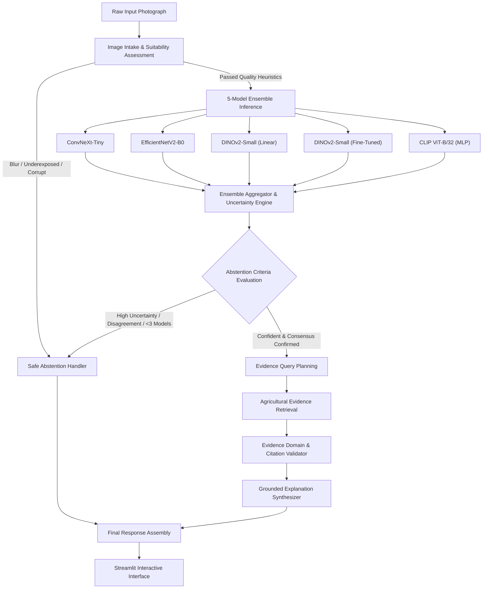

# System Architecture: Abstention-Aware Plant Disease Recognition

This document details the architectural layout, data flow, uncertainty quantification, and agentic LangGraph orchestration behind the system.

## 1. Modular Subsystems

### A. Image Validation Layer (`plant_disease_agent.image_validation`)
Before feeding pixels to heavy vision backbones, the intake layer validates:
- Image decoding and EXIF orientation normalization via `PIL.ImageOps.exif_transpose`.
- Strict RGB mode conversion.
- Spatial resolution limits (minimum 64x64 pixels).
- Aspect ratio boundaries (maximum 4:1).
- Exposure limits (normalized mean pixel intensity bounded in $[0.05, 0.95]$).
- Sharpness heuristics via discrete Laplacian variance filter.

### B. Deep Ensemble Inference Engine (`plant_disease_agent.model_adapters`)
Integrates five heterogeneous architectures across distinct inductive biases:
1. **Pure Modern CNN:** ConvNeXt-Tiny (inverted bottlenecks, $7\times 7$ depthwise convs).
2. **Compound Scaled Mobile CNN:** EfficientNetV2-B0 (`tf_efficientnetv2_b0`).
3. **Self-Supervised Vision Transformer:** DINOv2-Small Linear (standardized CLS representation).
4. **Fine-Tuned Vision Transformer:** DINOv2-Small Fine-Tuned (attention projection aligned).
5. **Multimodal Foundation Visual Encoder:** CLIP ViT-B/32 with custom L2-normalized MLP head.

### C. Uncertainty Quantification and Selective Abstention
The ensemble probability distribution is calculated via:
$$p_{\text{ens}} = \frac{1}{\sum_{m=1}^M w_m} \sum_{m=1}^M w_m p^{(m)}$$

Three primary orthogonal uncertainty metrics are tracked:
1. **Predictive Shannon Entropy (Nats):**
   $$H(p_{\text{ens}}) = -\sum_{c=1}^{29} p_{\text{ens}, c} \ln(p_{\text{ens}, c} + \epsilon)$$
2. **Top-2 Probability Margin:**
   $$\Delta p = p_{(1)} - p_{(2)}$$
3. **Inter-Model Disagreement:**
   $$D_{\text{models}} = \frac{1}{M} \sum_{m=1}^M \mathbf{1}\left(\operatorname{argmax} p^{(m)} \neq \operatorname{argmax} p_{\text{ens}}\right)$$

### D. Agentic Retrieval and Citation Verification
Implemented via a LangGraph state machine with conditional branching:
- Safe abstention route branches away from treatment suggestions to prevent harm.
- Query planner generates structured search intents from the predicted taxon.
- Evidence validator enforces domain whitelisting (`.edu`, `.gov`, `apsnet.org`, `cabi.org`, `fao.org`).
- LLM / Deterministic synthesizer grounds all assertions strictly in retrieved excerpts.
